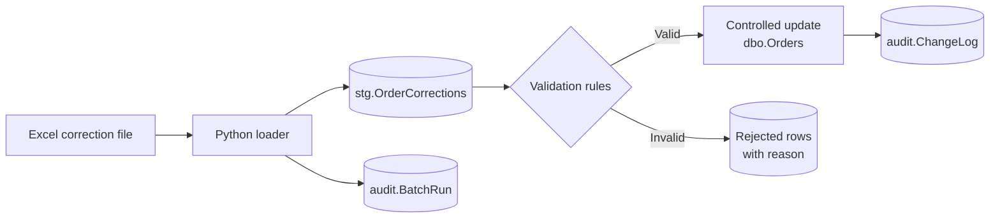

# Excel-to-SQL Data Correction Pipeline

A Python and SQL Server pipeline that loads business correction requests from Excel, validates every row, applies only valid changes, and keeps a full audit trail.

> All data in this repo is **synthetic** and generated by `src/generate_sample_data.py`.

## Problem

Operations teams often send data fixes in Excel. Running manual `UPDATE` statements is slow, error-prone, and hard to audit. This pipeline makes the process **repeatable, validated, and traceable**.

## Architecture



## Tech Stack

Python (pandas, pyodbc) · SQL Server (T-SQL) · Excel

## Project Structure

```text
excel-to-sql-data-correction-pipeline/
├── config/              # config.example.ini (copy to config.ini)
├── data/
│   ├── sample/          # Synthetic sample correction file
│   ├── input/           # Files to process (git-ignored)
│   └── archive/         # Processed files (git-ignored)
├── docs/                # Diagrams and screenshots
├── logs/                # Run logs (git-ignored)
├── sql/
│   ├── 01_create_schema.sql
│   ├── 02_seed_orders.sql
│   └── procs/           # Validation and update procedures
├── src/                 # Python scripts
├── tests/               # Tests
├── requirements.txt
└── README.md
```

## Database Objects

| Object | Purpose |
|---|---|
| `dbo.Orders` | Target table |
| `stg.OrderCorrections` | Raw Excel rows, validation status, reject reason |
| `audit.BatchRun` | One row per run: file, counts, status, errors |
| `audit.ChangeLog` | Old and new values for every changed column |

Staging columns are `VARCHAR` on purpose, so invalid values (for example `"ABC"` as an OrderID) still load and are rejected with a clear reason instead of failing the whole batch.

## Validation Rules

| Rule | Sample test case |
|---|---|
| OrderID must be numeric | `ABC` |
| OrderID must exist in target | `99999` |
| Status must be in the allowed list | `SHIPED` |
| Ship date must be a valid date | `31/31/2026` |
| Ship date cannot be before order date | Backdated row |
| At least one field must change | Empty row |
| RequestedBy is required | Blank requester |
| No duplicate OrderID in a batch | Duplicated row |

## Setup

```bash
python -m venv .venv
.venv\Scripts\activate          # Windows
pip install -r requirements.txt
copy config\config.example.ini config\config.ini
python src/generate_sample_data.py
```

In SSMS, run:

1. `sql/01_create_schema.sql`
2. `sql/02_seed_orders.sql`

Verify:

```sql
SELECT COUNT(*) AS OrderCount FROM dbo.Orders;  -- expect 500
```

## Roadmap

- [x] Phase 1: Schema, sample data, repo structure
- [ ] Phase 2: Python loader (Excel to staging, batch ID)
- [ ] Phase 3: Validation stored procedure
- [ ] Phase 4: Controlled update with dry-run and audit log
- [ ] Phase 5: Logging, config, error handling, rerun safety
- [ ] Phase 6: Tests and documentation

## Author

Surya Pratap Das
